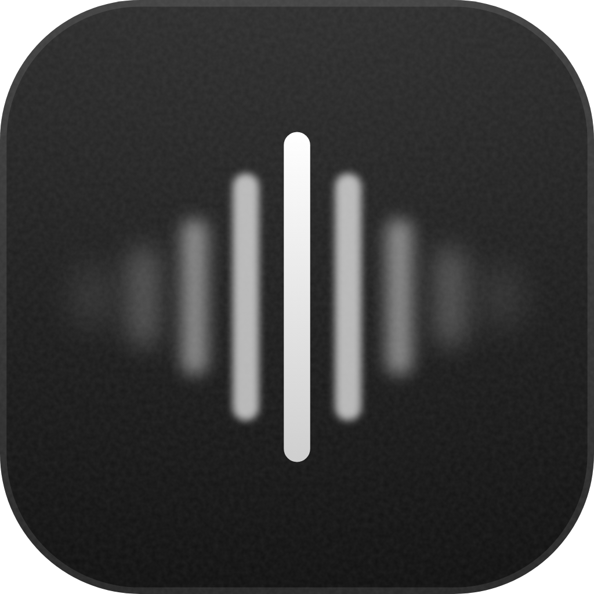

  
  <h1>Focal</h1>
  
Offline voice notes for Android. Speak, and it’s written down.

  

    <strong><a href="https://github.com/andreizpgh/Focal/releases/download/v0.5.0/Focal-0.5.0.apk">Download Focal 0.5.0</a></strong>
    &nbsp; · &nbsp;
    <a href="docs/install.md">Install guide</a>
    &nbsp; · &nbsp;
    <a href="https://github.com/andreizpgh/Focal/releases/tag/v0.5.0">Release notes</a>
  

  Android 8.0+ · ARM64 · ~0.7 GB · No internet permission · Testing release

 

  
  &nbsp;
  
  &nbsp;
  
  &nbsp;
  

Tap **Record** and talk. Text appears in paragraphs after each pause while you keep speaking. Tap **Finish**, fix or confirm any unclear word in place, and **Copy**.

- **Offline by construction.** [Parakeet Ultra INT8](docs/speech-quality.md) runs locally through `sherpa-onnx`. Focal declares no `INTERNET` permission, accounts, or analytics — audio and transcripts never leave your phone.
- **Built for long dictation.** Recording continues with the screen off or in the background, recovers transactionally from interruptions, and lets you continue recording into any finished note.
- **Automatic language detection.** Handles 25 European languages without a language picker; accuracy varies by language and recording ([multilingual results](docs/benchmarks/2026-11-19-multilingual/README.md)).
- **Edit and review in place.** Tap any word or **Review · N** to edit directly on the page with the keyboard open right away — listen to the clip, reuse an earlier edit from the same note in one tap, or confirm with **Keep** (all undoable).
- **Audio stays attached until you remove it.** Play back at **1× / 1.5× / 2×** with live word highlighting and paragraph timestamps, or delete audio per note or in bulk while keeping clean text.

### Status

Focal 0.5.0 is a **testing pre-release** (installs cleanly over 0.4.0 and 0.3.2). Automated JVM, lint, and Android 16 emulator suites pass with the bundled speech model; real-device ARM phone performance, thermal behavior, battery life, and natural dictation accuracy remain open in the [phone validation checklist](docs/testing.md#phone-validation). Check important transcripts against the original audio.

---

  <a href="docs/install.md">Install</a> ·
  <a href="docs/architecture.md">Architecture</a> ·
  <a href="docs/design.md">Design</a> ·
  <a href="docs/speech-quality.md">Speech quality</a> ·
  <a href="docs/review-and-research.md">Research</a> ·
  <a href="docs/testing.md">Testing</a> ·
  <a href="CONTRIBUTING.md">Contributing</a> ·
  <a href="CHANGELOG.md">Changelog</a> ·
  <a href="LICENSE">MIT License</a> (<a href="THIRD_PARTY_NOTICES.md">Notices</a>)

