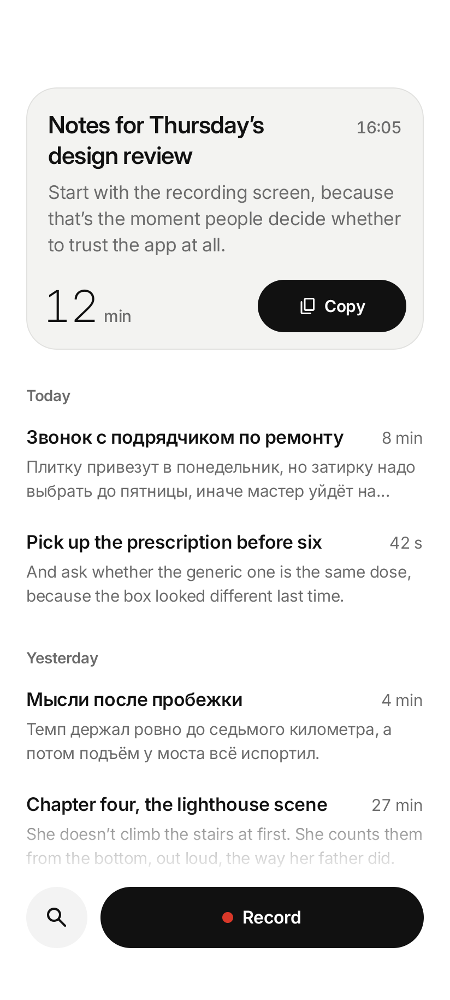

  
  <h1>Focal</h1>
  
Offline voice notes for Android. Speak, read, copy.

  

    <strong><a href="https://github.com/andreizpgh/Focal/releases/download/v0.5.1/Focal-0.5.1.apk">Download Focal 0.5.1</a></strong>
    &nbsp;·&nbsp;
    <a href="docs/install.md">Install guide</a>
    &nbsp;·&nbsp;
    <a href="https://github.com/andreizpgh/Focal/releases/tag/v0.5.1">Release notes</a>
  

  Android 8.0+ · ARM64 · ~0.7 GB · Zero network permissions · Testing pre-release

 

<table align="center">
  <tr>
    <td align="center"></td>
    <td align="center"></td>
    <td align="center"></td>
    <td align="center"></td>
  </tr>
  <tr>
    <td align="center">Library & one-tap Copy</td>
    <td align="center">Live capture</td>
    <td align="center">Synced playback</td>
    <td align="center">In-place review</td>
  </tr>
</table>

 

Tap **Record** and talk. Text develops in clean paragraphs after each pause while you keep speaking. Tap **Finish**, fix or confirm any flagged word right on the page, and **Copy**.

### Highlights

- **100% offline, by construction.** [Parakeet Ultra INT8](docs/speech-quality.md) runs locally through `sherpa-onnx` over a thin JNI/C API bridge. No `INTERNET` permission, no accounts, no telemetry — audio and text never leave the phone.
- **Built for long dictation.** Captures in the background with the screen off, syncs PCM audio to disk every second, recovers transactionally from calls or process death, and lets you continue recording into any finished note.
- **25 European languages, zero setup.** Automatic language detection with no picker; recognition accuracy varies by language and recording ([25-language benchmark](docs/benchmarks/2026-11-19-multilingual/README.md)).
- **One-thumb editing and review.** Tap any word to edit with **Listen** and **Done** directly above the keyboard, or tap **Review · N** to step through low-confidence words with audio replay, same-note/spell-checker suggestions, and undoable **Keep**.
- **Audio stays attached until you drop it.** Play back from **0.5× to 2×** (in `0.25×` steps, tap or press-and-drag) with live word highlighting, or batch **Copy**, **Share**, and **Remove audio** from the library.

### Under the hood

| Area | Summary | Deep dive |
| --- | --- | --- |
| **Speech & JNI** | Parakeet Ultra INT8 + Silero VAD v4 via pinned `sherpa-onnx` 2.0.1 C API (`focal_speech.cpp`), bounded 20 s windows, immutable raw recognizer output | [Architecture](docs/architecture.md) |
| **UI & Motion** | Custom Jetpack Compose design system, critically damped spring physics, steady frame clock, and dual-layout shared-element page transitions | [Design](docs/design.md) |
| **Quality & Research** | FLEURS & 25-language benchmarks, word-confidence calibration, and why local 0.6B–2B LLMs and synthetic punctuation were kept out of the APK | [Speech quality](docs/speech-quality.md) · [Research](docs/review-and-research.md) |
| **Verification** | Core Kotlin & app unit tests, Android 16 instrumented suite with bundled model, screenshot gallery, and signed APK verification | [Testing](docs/testing.md) · [Contributing](CONTRIBUTING.md) |

### Status

Focal **0.5.1** is a testing pre-release (installs cleanly over 0.5.0, 0.4.0, and 0.3.2). Host JVM tests, lint, and Android 16 emulator suites pass with the bundled model; physical ARM phone speed, thermal behavior, battery draw, and natural dictation accuracy remain open in the [phone validation checklist](docs/testing.md#phone-validation). Check important transcripts against the original audio.

---

  <a href="docs/install.md">Install</a> ·
  <a href="docs/architecture.md">Architecture</a> ·
  <a href="docs/design.md">Design</a> ·
  <a href="docs/speech-quality.md">Speech quality</a> ·
  <a href="docs/review-and-research.md">Research</a> ·
  <a href="docs/testing.md">Testing</a> ·
  <a href="CONTRIBUTING.md">Contributing</a> ·
  <a href="CHANGELOG.md">Changelog</a> ·
  <a href="LICENSE">MIT</a> (<a href="THIRD_PARTY_NOTICES.md">Notices</a>)

