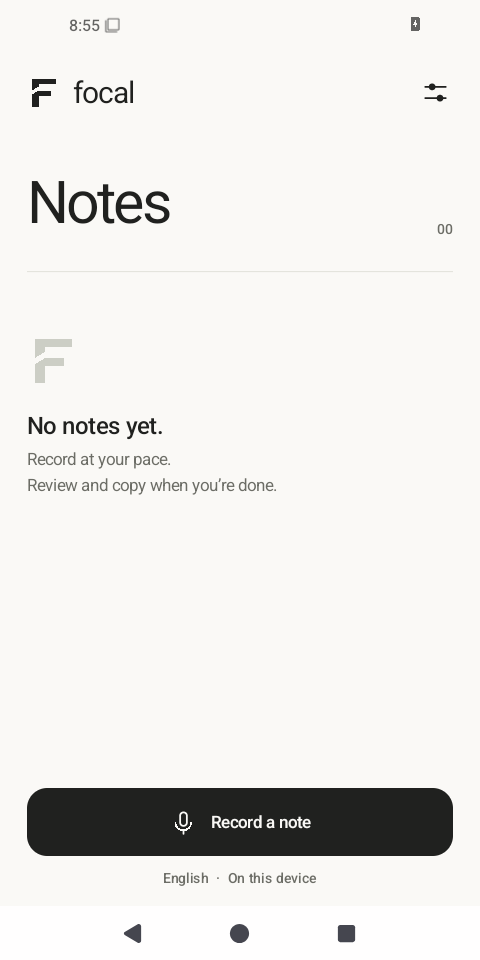

# Focal

Local voice notes for Android. Record, review, copy.

Focal records long thoughts, transcribes them on your phone, and marks passages
that may need a closer listen. A quiet interface, a light theme, and two settings:
speech language and appearance.

- Background recording with pause/finish controls in the notification.
- Original audio and completed text saved incrementally; interrupted work can be recovered.
- Listen to a passage, edit it, then move to the next review cue.
- Copy or share the complete edited transcript. Remove audio when you no longer need it.
- English interface; English, Russian, German, French, Spanish, Italian, and Portuguese speech.
- No accounts, analytics, cloud transcription, or Internet permission.



## Try it

**Early development build.** In [Actions](https://github.com/andreizpgh/Focal/actions/workflows/android.yml),
open a successful run and download `Focal-debug` from its artifacts. Extract and
install `app-debug.apk`. CI bundles the multilingual speech model, so the app
works offline after installation. This is a debug-signed build, not a stable release.

Android 8.0+ and an ARM64 phone are required. x86-64 is included for emulators.
Select your speech language in Settings before the first recording; English is
the default. Allow microphone access and notifications, then tap **Record a note**.

Force-stopping Focal or rebooting ends recording. Manufacturer background limits
can also stop apps. Review cues are suggestions: unmarked text can contain errors.
Phone-specific accuracy, battery use, and thermal behavior still need the
[device validation](docs/device-validation.md) checks, particularly for Russian
and hour-long recordings.

## Build

JDK 17, Android SDK 35, NDK 28.0.13004108, and CMake 3.22.1. Set `ANDROID_HOME`
or `sdk.dir` in an untracked `local.properties`.

```sh
git submodule update --init --recursive
python3 scripts/fetch-model.py
./gradlew :core:test :app:lintDebug :app:assembleDebug
```

`app/build/outputs/apk/debug/app-debug.apk` is the installable output. The model
downloader verifies the SHA-256 and immutable revision pinned in `models/model.json`.
Model binaries are excluded from Git. Without the model, a debug build can still
exercise the interface; it cannot transcribe until a model is imported.

The engine is whisper.cpp v1.8.2 with multilingual Whisper base Q5_1, about 57 MB.
Capture and inference run independently. The energy gate avoids inference during
long pauses; the original remains intact. Inference uses at most two CPU threads
and yields under thermal pressure. Audio uses about 115 MB per recorded hour;
deleting audio keeps the text. See [architecture](docs/architecture.md) for the
tradeoffs and recovery boundaries.

For tests, contributing, and reproducible builds, see [CONTRIBUTING.md](CONTRIBUTING.md).

## License

MIT. [Third-party notices](THIRD_PARTY_NOTICES.md) are also included in the app.
