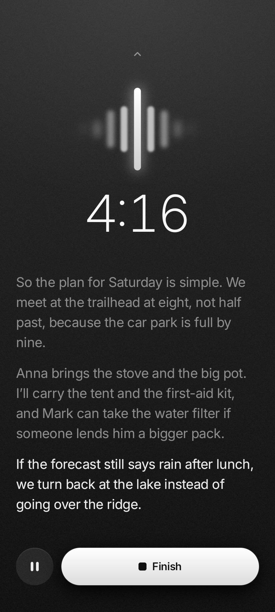
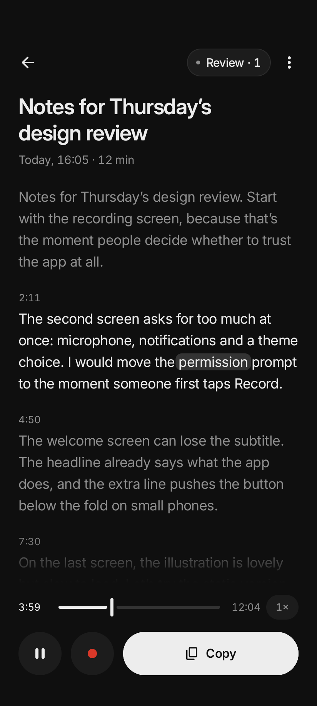
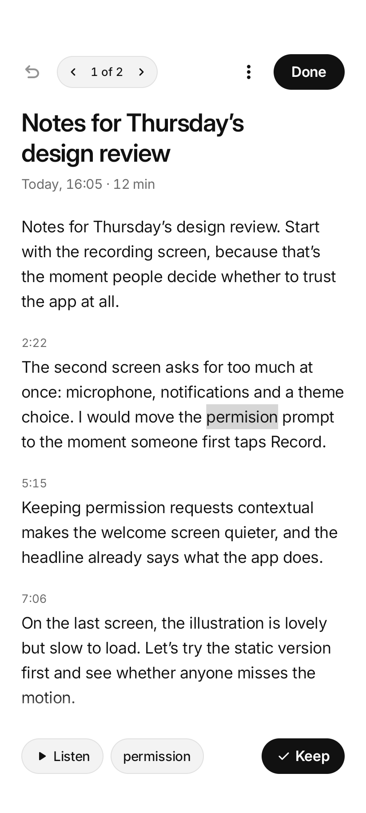

  
  <h1>Focal</h1>
  
Offline voice notes for Android.

  

    <strong><a href="https://github.com/andreizpgh/Focal/releases/download/v1.0.0/Focal-1.0.0.apk">Download Focal 1.0.0</a></strong>
    &nbsp;·&nbsp;
    <a href="docs/install.md">Install guide</a>
    &nbsp;·&nbsp;
    <a href="https://github.com/andreizpgh/Focal/releases/tag/v1.0.0">Release notes</a>
  

  Android 8.0+ · ARM64 · ~0.7 GB · No internet permission

 

  
  &nbsp;
  
  &nbsp;
  
  &nbsp;
  

 

Tap **Record** and start talking. Text appears in paragraphs after each pause while you keep speaking. When you finish, fix any mistakes directly on the page and copy the text.

- **Offline speech recognition.** Uses [Parakeet Ultra INT8](docs/speech-quality.md) locally through `sherpa-onnx` over a small JNI bridge. The app declares no `INTERNET` permission, accounts, or analytics.
- **Background capture and recovery.** Keeps recording with the screen off, syncs PCM audio to disk every second, recovers from calls or process death without losing saved audio, lets you continue recording into an existing note, and starts quickly from the Quick Settings tile, app shortcut, or home-screen widget.
- **Automatic language detection.** Supports 25 European languages without a language picker. Accuracy varies noticeably across languages and speakers ([multilingual benchmark](docs/benchmarks/2026-11-19-multilingual/README.md)).
- **In-place editing and review.** Tap any word to edit it directly with **Listen** and **Done** right above the keyboard, or tap **Review · N** to step through low-confidence words, replay the surrounding audio, and apply suggestions or confirm with **Keep**.
- **Audio playback and data ownership.** Play back from 0.5× to 2× (0.25× steps) with word-level highlighting, copy or share multiple selected notes at once, export all notes as Markdown, back up and restore archives offline, or delete audio files while keeping the text.

### Status

Focal 1.0.0 installs directly over 0.3.2–0.5.7 and migrates notes from Alpha 2–9. Unit tests, lint, Android 16 emulator suites (with the bundled model), and an initial physical-device check on a 6 GB POCO M4 Pro (Android 13 / HyperOS, ONNX CPU arena off) are recorded in [testing](docs/testing.md). Long 60-minute screen-off battery/thermal runs, Android 14–16 phone checks, and quantitative multi-device dictation scoring remain open in the [phone checklist](docs/testing.md#phone-validation). Check important transcripts against the original audio.

---

  <a href="docs/install.md">Install</a> ·
  <a href="docs/architecture.md">Architecture</a> ·
  <a href="docs/design.md">Design</a> ·
  <a href="docs/speech-quality.md">Speech quality</a> ·
  <a href="docs/review-and-research.md">Research</a> ·
  <a href="docs/testing.md">Testing</a> ·
  <a href="CONTRIBUTING.md">Contributing</a> ·
  <a href="CHANGELOG.md">Changelog</a> ·
  <a href="LICENSE">MIT</a> (<a href="THIRD_PARTY_NOTICES.md">Notices</a>)

