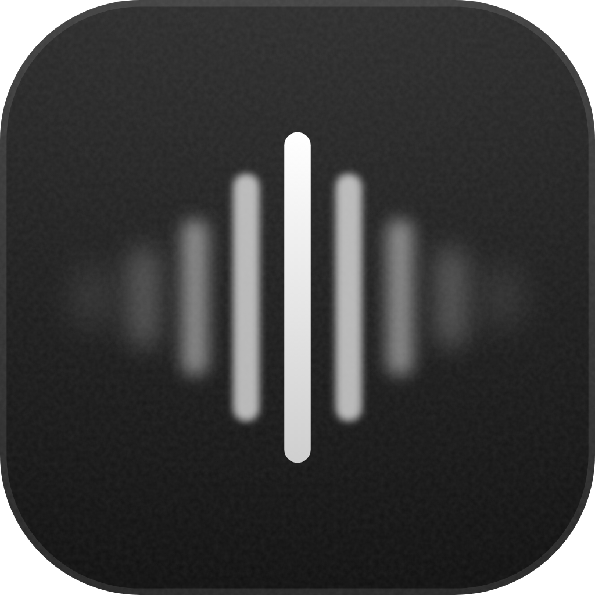

  
  <h1>Focal</h1>
  
Offline voice notes for Android. Record, review, and copy.

  

    <strong><a href="https://github.com/andreizpgh/Focal/releases/download/stt-alpha-8/Focal-0.1.0-alpha.8.apk">Download Alpha 8</a></strong>
    &nbsp; · &nbsp;
    <a href="docs/install.md">Install guide</a>
    &nbsp; · &nbsp;
    <a href="https://github.com/andreizpgh/Focal/releases">Releases</a>
  

  Android 8.0+ · ARM64 · Version 0.1.0-alpha.8 · 815 MB

 

**Record at your pace.** Pause, resume, or leave the app while recording continues.

**Review uncertain passages.** Listen to the original audio and edit the text.

**Check background sound.** Listen to suggested ranges and choose which text to keep. Exclusions can be restored.

**Try Ultra on a finished recording.** Copy a separate transcription of up to three minutes of saved audio. Your saved transcript and edits stay intact.

**Copy and keep.** Copy or share your transcript. Remove audio when you’re finished.

---

Speech recognition runs on your phone. The models are included in the APK.
No account, cloud service, tracking, or Internet permission.

English · **Русский** · Deutsch · Français · Español · Italiano · Português

This is a testing release. Review important transcripts; speech quality and
background recording still need validation on real phones.

---

[Build & contribute](CONTRIBUTING.md) · [Interface preview](docs/interface-preview.md) · [Architecture](docs/architecture.md) · [Testing](docs/device-validation.md) · [MIT license](LICENSE)
