> These screenshots show Alpha 6. Alpha 7 adds the optional background-sound check and further library/settings polish; see its [release notes](releases/ux-alpha-7.md).

# Interface preview

## UX Alpha 6 · 2026-11-04

Actual, unretouched captures from the verified 0.1.0-alpha.6 APK at 411×890dp on
the dedicated Android 15 emulator. The note is synthetic, not an accuracy example.
[Download Alpha 6](https://github.com/andreizpgh/Focal/releases/tag/ux-alpha-6) ·
[Build and QA identity](../releases/ux-alpha-6.json)

| Recording | Settings |
| --- | --- |
| 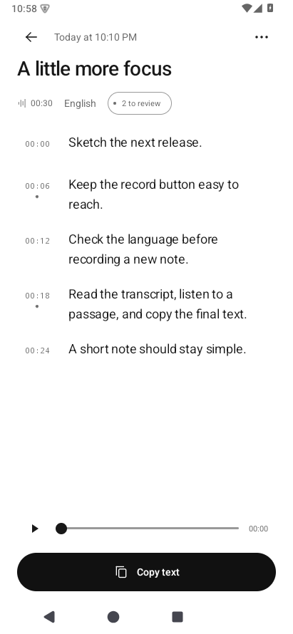 | 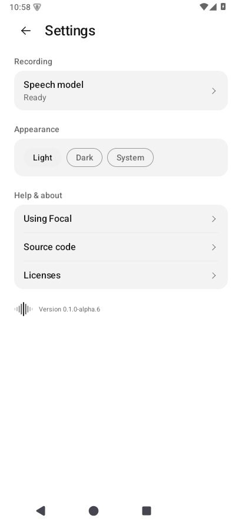 |

The library header follows the visible day and opens a day filter. Live transcripts
follow the newest words until the user scrolls up; Latest resumes. Page content
stays opaque during a short 160 ms / 8 dp movement. Four actual page transitions were
inspected frame by frame without opacity-induced blank frames. One note opening
briefly shows the normal loading indicator during its asynchronous read.
Emulator recordings do not establish phone frame rate. Owner screenshots stay private.

## Earlier UX Alpha 5 · 2026-11-04

Actual, unretouched captures of the verified `0.1.0-alpha.5` APK on the dedicated
Android 15 emulator at 411 × 890 dp. The note is our synthetic UI fixture, not an
accuracy example. Owner screenshots remain private.
[Download Alpha 5](https://github.com/andreizpgh/Focal/releases/tag/ux-alpha-5) ·
[Build and QA identity](../releases/ux-alpha-5.json)

| Session | Editor | Settings |
| --- | --- | --- |
| 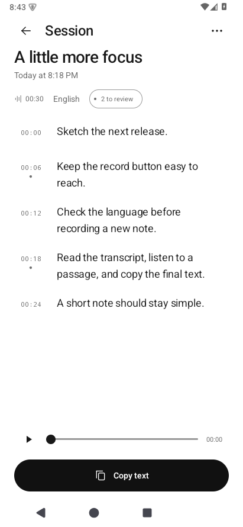 | 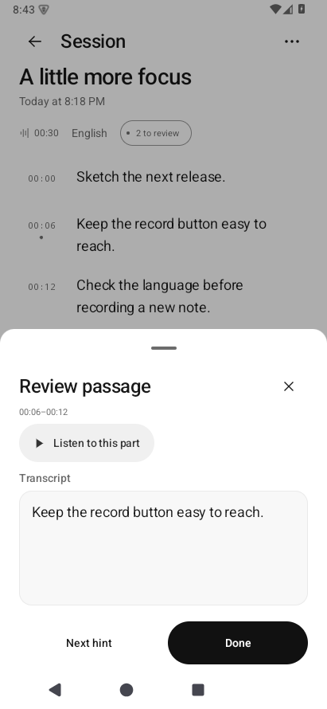 | 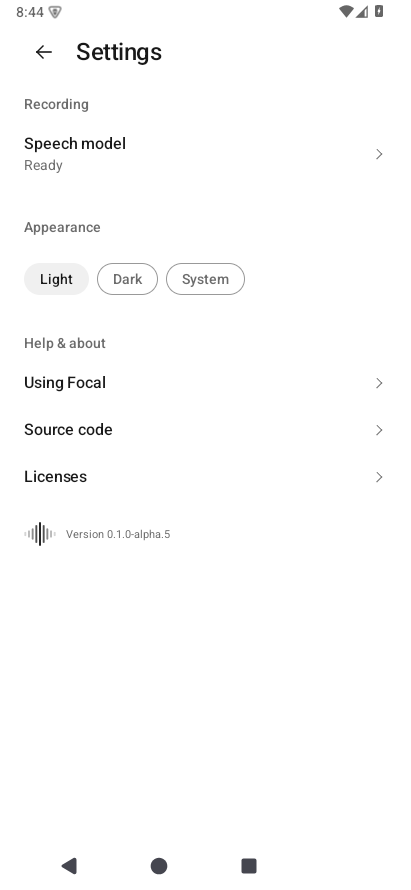 |

Search and result/filter movement were checked in actual screen recordings, including
entry and exit frames. Long-press exposes the session actions sheet; Copy shows a
brief check and confirmation. Reduced-motion checks covered search, editor and actions.
These checks do not establish smoothness or frame rates on a physical phone.

## Earlier UX Alpha 4 · 2026-11-04

Actual, unretouched captures of the verified `0.1.0-alpha.4` APK on the dedicated
Android 15 emulator at 411 × 890 dp. The note is a synthetic UI fixture, not an
accuracy example. Owner screenshots remain private.
[Download Alpha 4](https://github.com/andreizpgh/Focal/releases/tag/ux-alpha-4) ·
[Build and QA identity](../releases/ux-alpha-4.json)

| Active passage | Editor · light | Editor · dark |
| --- | --- | --- |
| 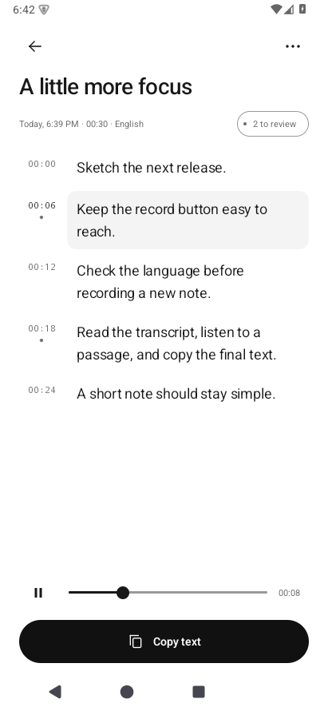 | 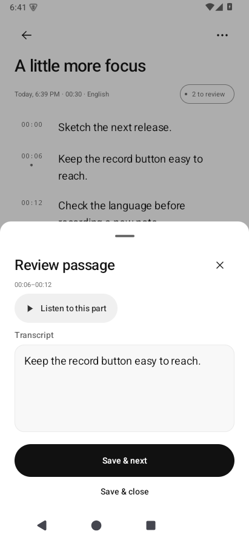 | 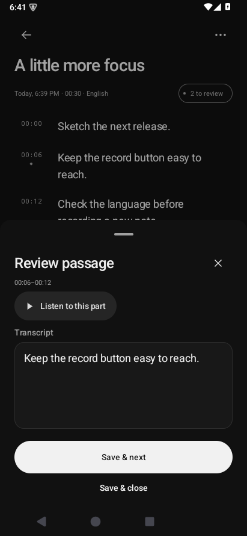 |

## Earlier UX Alpha 3 · 2026-11-04

Actual captures of the verified `0.1.0-alpha.3` APK on the dedicated Android 15
emulator, 411 × 891 dp. All notes are synthetic UI fixtures; these images do not
represent recognition accuracy. The owner's feedback screenshots are private.
[Download Alpha 3](https://github.com/andreizpgh/Focal/releases/tag/ux-alpha-3) ·
[Build and QA identity](../releases/ux-alpha-3.json)

| Speech language | Session actions | Passage editor · dark |
| --- | --- | --- |
| 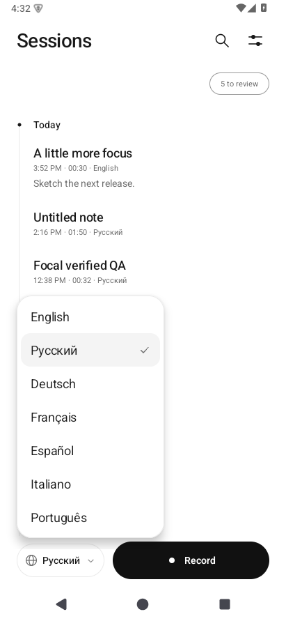 | 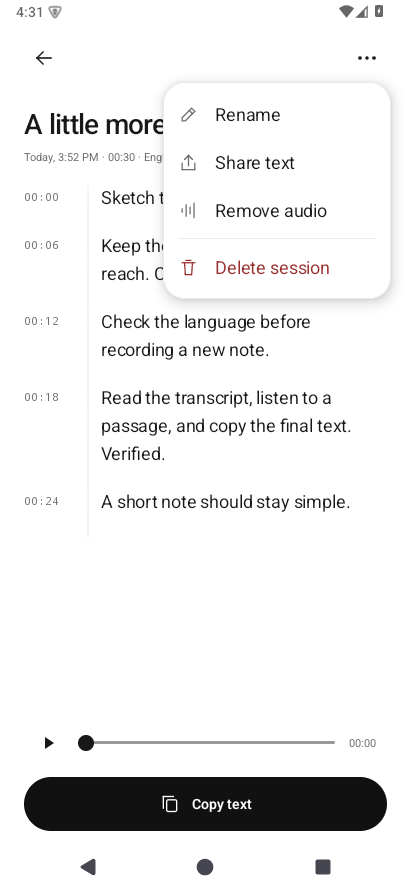 | 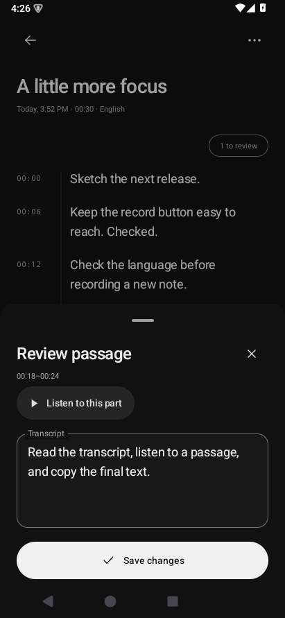 |

## Earlier Sessions / Focus wave captures

The following native Android captures are from 2026-11-02 on Android 10 at
approximately 390 × 846 dp. Some controls have since changed. The recording
capture uses synthetic session state to exercise layout, not actual capture
or recognition quality.

| Sessions · light | Sessions · dark |
| --- | --- |
| 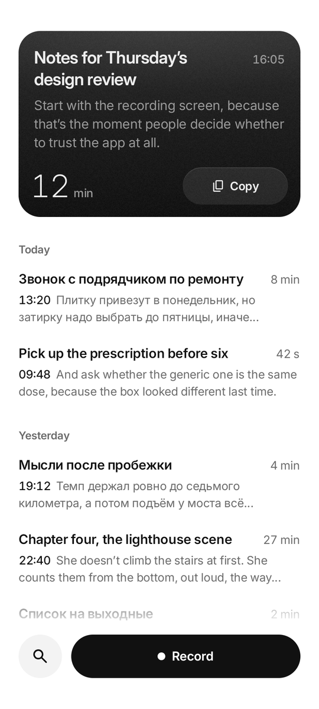 | 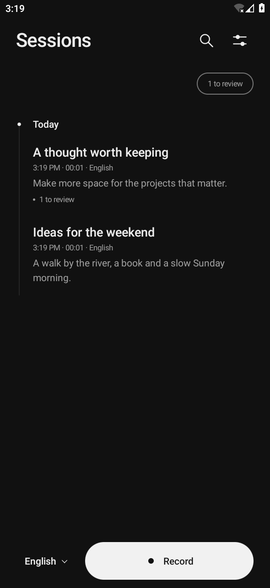 |

| Recording controls | Processing status |
| --- | --- |
| 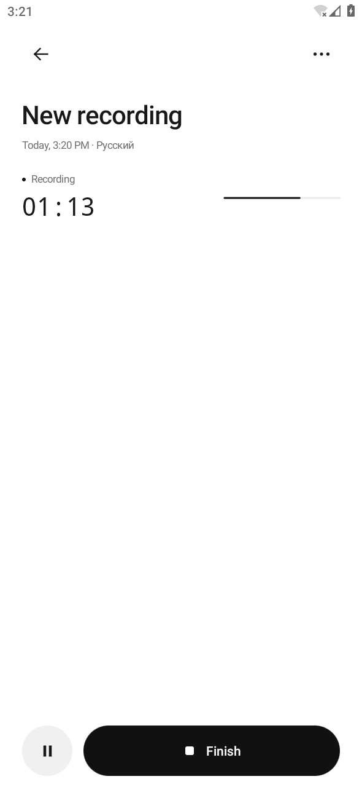 | 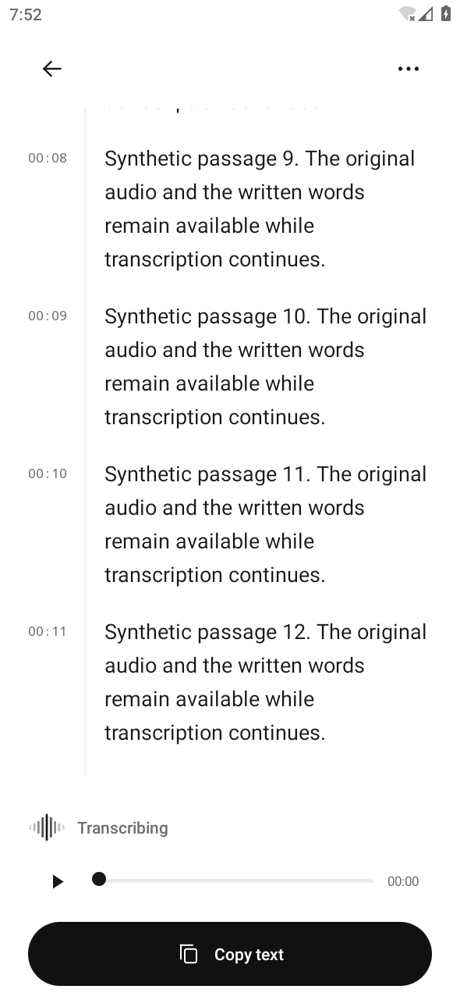 |

| Note · light | Note · dark |
| --- | --- |
| 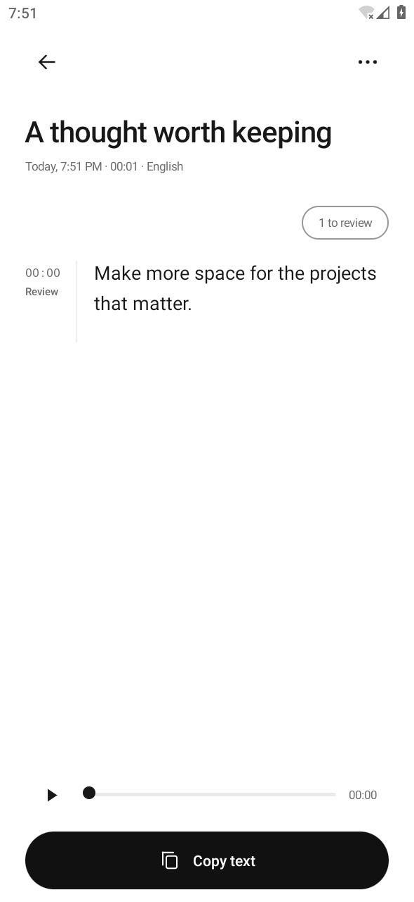 | 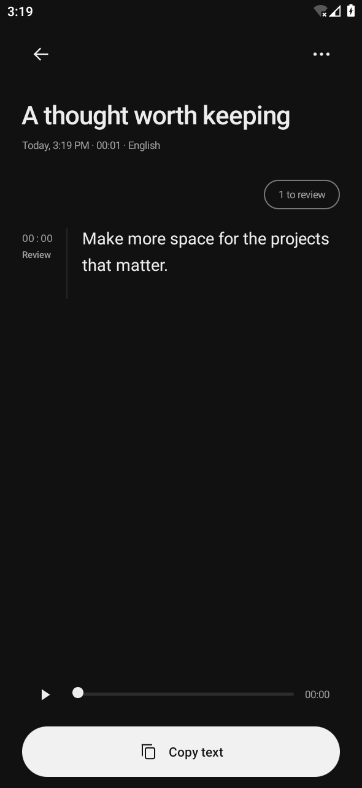 |

[Vector logo](mark.svg) · [Logo preview](mark-preview.png)

[Approved brand sources and rebuild instructions](../design/brand/README.md)

The selected Sessions direction uses a white canvas, black primary actions and
a dated timeline. Recording uses an open timer and a Focus wave amplitude envelope
driven by the actual microphone level, with brief smoothing and a settled paused
state. This is a live level meter, not a stored audio waveform;
transcript passages are timed text with review cues. The app name and redundant
helper copy are absent from the header and recording footer. The approved Focus
wave launcher retains selective blur, its central highlight and subtle material.
Themed, notification and compact UI marks use crisp geometry; the themed/UI
variants retain the opacity falloff. Source assets and outlined wordmarks are
versioned with a reproducible generator.

During transcription, the compact Focus wave changes bar heights in a visible
repeating sweep; the surrounding text and layout remain still. One status sits above the audio/copy dock
and stays visible when the transcript scrolls. It is indeterminate: no invented
completion percentage. The animation stops when processing ends or the UI leaves
STARTED, and becomes static when system animations are disabled. No delayed launch
animation, idle decorative loop or runtime Gaussian blur was added. The settings
footer uses the same mark beside the version.

The record action stays at the bottom with an explicit speech-language selector.
Search covers titles and every passage, including Unicode text; the review filter includes interrupted notes.
Notes expose original-audio playback, editable passages and a persistent copy
button. The editor preserves its draft across recreation, confirms discarding
changes, survives same-session notification navigation, and waits for a successful
save before advancing. Original-audio playback supports seeking and pause/resume.
Light, dark and system
appearance use the same spacing and component hierarchy.

Search input is dismissed when opening a note or another screen. Saving or closing
the passage editor also dismisses its keyboard.

The speech changes and their limits are described in [architecture](architecture.md).
Quality across languages needs the [corpus and phone checks](device-validation.md);
UI screenshots and emulator tests do not establish recognition accuracy or latency.

To reproduce captures on a clean emulator, build/install both debug APKs and run:

```sh
adb shell am instrument -w -r -e screenshots true -e class app.focal.InterfaceTest app.focal.test/androidx.test.runner.AndroidJUnitRunner
adb pull /sdcard/Android/data/app.focal/files/screenshots build/ui-captures
```

Screenshots are opt-in and use the test fixtures in `InterfaceTest`. Do not run
capture mode against an installation containing personal notes.

## Working-tree verification · 2026-11-02

The required core/lint/debug build checks pass, along with release lint and R8
compilation. The Android checks cover all seven language selections, 200% font
scale at 320 × 560 dp, activity recreation, notification navigation, original-audio
playback, exact Russian copy, and failed SQLite writes without losing the draft.

See the [quality report](quality-report.md) for counts, independent review and the
remaining real-model/device gates. Screenshots are direct, unretouched Android
captures. They do not establish speech accuracy, phone latency or release readiness.
